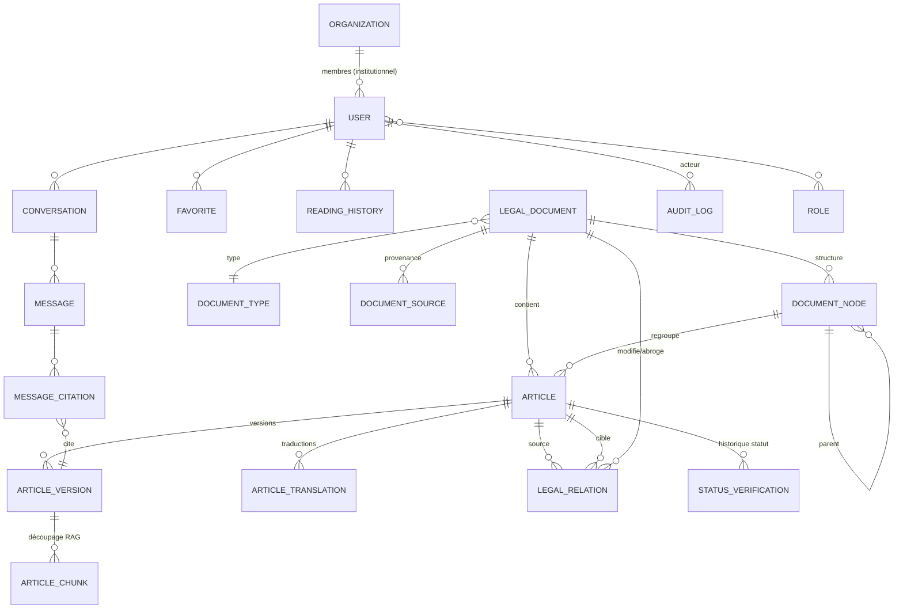

# LALWA — Phase 0 : Analyse, PRD & Architecture

> **Statut : EN ATTENTE DE VALIDATION.** Aucun code applicatif n'est écrit tant que ce document n'est pas approuvé (workflow GOVIBE : comprendre → analyser → architecture → risques → **validation** → un module à la fois).
> Produit : **LALWA** — *Le droit haïtien, accessible à tous.* — lalwa.org · initié par GOVIBE Innovation Hub.
> Version du document : 0.1 — 2026-11-18.

**Règle éditoriale appliquée dans ce document :** aucun texte de loi, numéro d'article, nombre d'articles ou statut juridique n'est présenté comme vérifié. Toute référence juridique citée ici sert à illustrer un problème d'architecture et porte la mention *à vérifier*. Les maquettes et jeux de données de démonstration utiliseront des enregistrements marqués **EXEMPLE FICTIF**.

---

## Sommaire

0. Décisions à prendre avant la Phase 1
- A. PRD (Product Requirements Document)
- B. Architecture système
- C. Sitemap
- D. Parcours utilisateurs (desktop & mobile)
- E. Design system UI/UX
- F. Modèle de données (ERD)
- G. Structure du projet
- H. Périmètre MVP
- I. Roadmap
- J. Complexité & infrastructure
- K. Risques
- L. Synergies écosystème GOVIBE

---

## 0. Décisions à prendre avant la Phase 1

| # | Décision | Recommandation | Pourquoi |
|---|---|---|---|
| D1 | **Où vit le code** | Dossier `lalwa/` dans le monorepo `govibe`, CI filtrée par chemin, **extractible** plus tard (`git subtree split`) vers un dépôt dédié | Même modèle que `Modules/Tagtoa` / `govibe-ai` (produits autonomes, déploiements séparés). Un dépôt dédié est préférable à terme (gouvernance d'intérêt public, partenaires institutionnels, éventuelle fondation), mais rien ne bloque d'y migrer sans perte d'historique. |
| D2 | **Stack backend** | **TypeScript de bout en bout** : NestJS (API) + Next.js (web) + Expo (mobile), monorepo pnpm/Turborepo | Un seul langage pour web, mobile et API = types, schémas de validation, i18n et tokens de design **partagés**. *Contre-argument honnête :* l'écosystème GOVIBE est Laravel ; Laravel + Postgres/pgvector serait viable. Mais l'app Expo et le front Next.js imposent déjà TS, et le partage de contrats API supprime une classe entière de bugs. |
| D3 | **Ordre de construction** | **Tranche verticale** « Constitution de bout en bout » avant de finir tout le design | Le chemin critique n'est pas l'UI, c'est **le corpus vérifié**. Construire une UI complète sur des données fictives retarde le vrai risque. Voir §I. |
| D4 | **Sources du corpus** | Roosevelt / l'équipe éditoriale fournit (ou autorise la collecte de) sources officielles : *Le Moniteur*, publications officielles, PDF institutionnels | Je ne dois pas — et ne vais pas — fabriquer de texte juridique. Sans corpus source, l'assistant IA n'a rien sur quoi s'appuyer. |
| D5 | **Responsable éditorial juridique** | Nommer au moins **un juriste réviseur** (partenariat Faculté de Droit / Barreau) avant toute publication d'un statut « Vérifié en vigueur » | La crédibilité de LALWA repose sur la vérification humaine, pas sur le code. |
| D6 | **CLAUDE.md** | Créer `lalwa/CLAUDE.md` dédié | Le `CLAUDE.md` racine décrit TAGTOA (Laravel/MySQL, multi-tenant, ledger) ; ses contraintes ne s'appliquent pas à LALWA et inversement (provenance juridique, RAG ancré, statuts). |

---

## A. PRD — Product Requirements Document

### A.1 Problème

L'information juridique haïtienne est aujourd'hui dispersée (PDF scannés, numéros du *Moniteur* difficiles d'accès, compilations privées payantes, copies non sourcées sur les réseaux sociaux). Conséquences :
- Le citoyen ne connaît pas ses droits et ne peut pas vérifier ce qu'on lui affirme.
- L'avocat / l'étudiant perd du temps à retrouver un article et sa version applicable.
- Personne ne sait facilement **si un texte est en vigueur, modifié ou abrogé.**
- Une large part de la population lit difficilement le français juridique ; le créole est la langue commune.

### A.2 Proposition de valeur

| Cible | Valeur LALWA |
|---|---|
| Citoyen | Trouver un article, le comprendre en langage simple, **à l'oral**, en créole |
| Étudiant en droit | Bibliothèque structurée, navigation par article, favoris, historique |
| Avocat / magistrat | Recherche exacte rapide (« art. X du Code civil »), versions, sources, liens entre textes |
| Journaliste / ONG | Citations traçables vers la source officielle |
| Entrepreneur | Droit commercial / travail accessible, sans consultation pour chaque question basique |
| Institutions | API, espaces équipe, statistiques — revenus récurrents |

### A.3 Principes non négociables

1. **Traçabilité** : chaque article affiché renvoie à sa source (document officiel, date, page).
2. **Statut explicite** : jamais « en vigueur » sans vérification humaine. Statuts : `VERIFIE_EN_VIGUEUR`, `MODIFIE`, `ABROGE`, `HISTORIQUE`, `A_VERIFIER` (défaut).
3. **Texte officiel ≠ traduction ≠ explication IA** : trois couches visuellement et techniquement distinctes.
4. **L'IA ne fabrique rien** : toute citation produite par l'IA doit correspondre à un article récupéré dans la base ; sinon elle est supprimée et l'incertitude affichée.
5. **Accès public gratuit** aux textes fondamentaux, pour toujours.
6. **Voix d'abord** : utilisable par une personne qui lit ou tape difficilement.
7. **Faible bande passante** : téléphone Android d'entrée de gamme, 3G instable.

### A.4 Exigences fonctionnelles (priorisées MoSCoW)

| ID | Exigence | Priorité MVP |
|---|---|---|
| F1 | Recherche exacte d'article (« Constitution art. 276-2 », « C. civ. 148 ») | Must |
| F2 | Recherche plein texte avec surlignage, filtres type/statut/date | Must |
| F3 | Lecteur de document structuré (TDM, article par article, préc./suiv., taille du texte) | Must |
| F4 | Interface FR + HT, sélecteur de langue visible, architecture prête pour EN | Must |
| F5 | Fiche source et statut par document et par article | Must |
| F6 | Back-office : import, correction OCR, revue, publication, historique des révisions | Must |
| F7 | Recherche sémantique / langage naturel (hybride) | Should |
| F8 | LALWA AI (RAG ancré, citations vérifiées, avertissement) | Should (bêta limitée) |
| F9 | Saisie vocale (STT) FR ; HT en bêta | Should |
| F10 | Lecture vocale (TTS) des articles et réponses | Should |
| F11 | Compte : favoris, historique, paramètres | Should |
| F12 | Amendements / versions d'article navigables | Could (modèle prêt dès le MVP) |
| F13 | Jurisprudence | Won't (MVP) — dépend de l'accès aux décisions |
| F14 | App mobile native Expo | Won't (MVP) — la PWA couvre le besoin initial |
| F15 | Premium / institutionnel, API partenaire | Won't (MVP) — modèle de données prêt |

### A.5 Exigences non fonctionnelles

| Domaine | Cible |
|---|---|
| Performance | Page article : < 100 Ko transférés (hors police), LCP < 2,5 s en 3G rapide ; recherche exacte p95 < 150 ms ; plein texte p95 < 400 ms |
| Disponibilité | 99,5 % MVP → 99,9 % à l'échelle |
| Accessibilité | WCAG 2.2 AA ; navigation clavier complète ; lecteurs d'écran ; zoom 200 % sans perte |
| Hors-ligne | PWA : Constitution + articles consultés disponibles hors ligne |
| Sécurité | OWASP ASVS niveau 2 sur l'API ; RBAC ; journal d'audit inaltérable des modifications juridiques |
| Confidentialité | Conversations IA : rétention configurable (défaut 30 j), anonymisation, pas d'entraînement sur les données utilisateurs |
| Échelle | Architecture conçue pour des millions de lectures/mois (lecture = cache/CDN), écriture rare (éditoriale) |

### A.6 Indicateurs de succès (12 mois)

- Couverture : Constitution + N codes **vérifiés** (N fixé avec l'équipe éditoriale).
- Recherche : taux de « recherche sans clic » < 30 %.
- IA : 0 citation inventée en production (mesuré par validation automatique + échantillonnage humain).
- Usage : utilisateurs actifs mensuels, part mobile, part créole, part voix.
- Revenus : premiers contrats institutionnels (universités, cabinets).

---

## B. Architecture système

### B.1 Vue d'ensemble

```
                 ┌──────────────────────── Cloudflare (DNS, CDN, WAF, cache) ───────────────────────┐
                 │                                                                                   │
  Navigateur / PWA ──► Next.js (SSR/ISR, i18n, PWA)  ──►  API NestJS (REST /v1)  ──►  PostgreSQL 16+
  App Expo (Ph.4) ───────────────────────────────────►        │                      ├─ tables juridiques
                                                              │                      ├─ FTS (tsvector)
                                                              │                      └─ pgvector (embeddings)
                                                              ├─► Redis (cache, rate limit, file d'attente BullMQ)
                                                              ├─► Stockage S3-compatible (PDF sources, audio)
                                                              ├─► Workers (ingestion, OCR, embeddings, TTS)
                                                              └─► Passerelles fournisseurs (abstraites) :
                                                                   LLM · Embeddings · STT · TTS
```

**Monolithe modulaire**, pas de microservices au MVP. Les workers sont le même code NestJS lancé dans un autre processus (même image Docker, commande différente).

### B.2 Modules backend (NestJS)

| Module | Responsabilité | Dépend de |
|---|---|---|
| `auth` | Sessions, JWT courte durée + refresh rotatif, OAuth (Google) plus tard | `users` |
| `users` | Profils, préférences (langue, taille texte, voix) | — |
| `legal-documents` | Documents, structure (titres/chapitres/sections), sources, statuts | `audit` |
| `articles` | Articles, versions, amendements, relations | `legal-documents`, `audit` |
| `search` | Résolution de référence exacte, FTS, sémantique, fusion hybride | `articles`, `embeddings` |
| `ai-assistant` | RAG, conversations, citations vérifiées, quotas | `search`, `llm` |
| `voice` | STT/TTS, cache audio, consentement micro | `storage` |
| `translations` | Traductions non officielles (HT/EN) d'articles, workflow de revue | `articles` |
| `favorites` | Favoris, historique de lecture | `users`, `articles` |
| `notifications` | Alertes (« un article suivi a changé de statut ») | `articles` |
| `admin` | Back-office éditorial, import, OCR, publication | tous |
| `audit` | Révisions, journal d'audit append-only | — |
| `providers/*` | Adaptateurs LLM / embeddings / STT / TTS (interfaces + implémentations) | — |

Règle : un module n'accède jamais aux tables d'un autre ; il passe par le service public du module.

### B.3 Moteur de recherche — pipeline

```
requête ─► normalisation (minuscules, accents, abréviations : "art.", "C. civ.", "Const.")
        ─► 1. Résolveur de référence exacte (grammaire déterministe)
              "Constitution article 276-2" → {doc: constitution-1987, article: "276-2"}
              ✔ trouvé → redirection directe vers l'article (pas de LLM, pas de vecteurs)
        ─► 2. Recherche lexicale  PostgreSQL FTS (config `french` + `unaccent` ; `simple` pour HT)
        ─► 3. Recherche sémantique pgvector (HNSW, distance cosinus) sur chunks d'articles
        ─► 4. Fusion RRF (Reciprocal Rank Fusion) + boosts (statut vérifié, document principal)
        ─► 5. Filtres (type, statut, période) appliqués en SQL avant classement
        ─► résultats : document, n° d'article, extrait surligné (ts_headline), statut, source
```

- **Pas de Meilisearch au MVP** : PostgreSQL FTS + pgvector couvre le besoin et évite un service à synchroniser. L'interface `SearchEngine` permet d'ajouter Meilisearch/OpenSearch plus tard si les volumes ou la tolérance aux fautes l'exigent.
- **Le créole n'a pas de stemmer Postgres** : configuration `simple` + table de synonymes/variantes orthographiques HT (ex. graphies alternatives) maintenue par l'équipe éditoriale.
- Un **jeu d'évaluation de recherche** (≈ 200 requêtes réelles annotées FR/HT) est construit dès la Phase 2 ; toute modification du classement est mesurée contre lui.

### B.4 LALWA AI — architecture RAG ancrée

```
question (texte ou voix transcrite)
  │
  ├─ 1. Garde-fous entrée : longueur, quota, détection langue, filtre d'injection
  ├─ 2. Réécriture / classification de requête (modèle léger) → sujet juridique, langue, références explicites
  ├─ 3. Récupération : pipeline §B.3 → top-k articles (k≈8–12), uniquement statut ≠ brouillon
  ├─ 4. Génération (modèle principal) avec :
  │      • system prompt figé (mis en cache) : rôle, limites, format, interdiction d'inventer
  │      • articles récupérés passés comme DONNÉES (blocs document), jamais comme instructions
  │      • sortie structurée (JSON schéma) :
  │        { resume, textes_applicables[], articles_cites[{article_id}], explication,
  │          procedures_possibles, points_avocat, niveau_incertitude }
  ├─ 5. Validation post-génération (code, pas IA) :
  │      • chaque article_id cité ∈ ensemble récupéré ? sinon → retiré + incertitude relevée
  │      • les textes officiels affichés proviennent de la BASE, jamais du texte généré
  └─ 6. Rendu : explication IA (bandeau « explication générée ») + cartes de citation (texte officiel
         depuis la base, statut, source) + avertissement permanent
```

- **Abstraction fournisseur** : interface `LlmProvider` (generate, stream, structured). Implémentation par défaut : API Claude (SDK officiel `@anthropic-ai/sdk`), modèle principal `claude-opus-5-5`, modèle léger `claude-haiku-5-5` pour la classification/réécriture. Changeable par configuration.
- **Embeddings** : interface `EmbeddingProvider`. Modèle multilingue (FR/HT) à choisir **après benchmark** sur le jeu d'évaluation — candidats auto-hébergeables (famille multilingue type BGE-M3 / E5) ou API. Le créole est la langue à risque.
- **Si aucune source pertinente n'est trouvée** : l'assistant le dit et propose la recherche manuelle, il ne répond pas « de mémoire ».
- **Avertissement visible en permanence** : « Les réponses de LALWA AI sont fournies à titre informatif et ne remplacent pas une consultation juridique professionnelle. »

### B.5 Voix

| Fonction | Primaire | Repli |
|---|---|---|
| STT FR | Web Speech API (navigateurs Chromium) | Upload audio → STT serveur |
| STT HT | STT serveur (modèle supportant le créole haïtien, à benchmarker) | Saisie texte |
| TTS FR | `speechSynthesis` du navigateur | TTS serveur + cache audio S3 |
| TTS HT | TTS serveur (voix créole à benchmarker) | Lecture FR + texte affiché |

- Détection de capacités côté client (`'webkitSpeechRecognition' in window`, voix disponibles) → l'UI n'affiche que ce qui fonctionne.
- **Licences** : plusieurs modèles open source couvrant le créole sont sous licence **non commerciale** — incompatible avec l'offre Premium. Vérification de licence obligatoire avant intégration (cf. §K).
- L'audio TTS des articles officiels est **pré-généré et mis en cache** (texte stable) → coût quasi nul à la lecture.
- Consentement micro explicite, aucune conservation de l'audio brut par défaut.

### B.6 i18n

- Interface : `next-intl` (web) / `i18next` (mobile), fichiers de messages partagés dans `packages/i18n` (`fr`, `ht`, `en` vide prêt).
- URL localisées : `/fr/...`, `/ht/...` (SEO + partage de liens dans la bonne langue).
- Contenu juridique : la langue est une **propriété de la donnée** (`original_language`), indépendante de la langue d'interface. Une traduction est un enregistrement séparé (`article_translations`) avec `is_official=false` par défaut et statut de revue.

### B.7 Hors-ligne & faible bande passante

- Pages articles en **ISR** (rendu statique régénéré à la publication) → servies par le CDN, quasi sans coût serveur.
- Service worker : cache « stale-while-revalidate » des articles consultés + pack hors-ligne téléchargeable (Constitution).
- Polices auto-hébergées, sous-ensemble latin étendu ; aucune bibliothèque d'icônes complète embarquée (icônes SVG à l'unité).

### B.8 Sécurité & gouvernance

| Menace | Contre-mesure |
|---|---|
| Modification non autorisée d'un texte | RBAC (`reader`, `contributor`, `editor`, `legal_reviewer`, `admin`) ; publication = double validation (éditeur + réviseur juridique) ; journal d'audit append-only |
| Injection de prompt via question ou document | Documents passés comme données ; system prompt figé ; sortie structurée ; validation des citations par code ; aucune action outil à effet de bord dans l'assistant |
| Abus / coûts IA | Rate limiting Redis par IP + compte ; quotas journaliers ; captcha léger au-delà d'un seuil anonyme |
| Upload malveillant | Types MIME vérifiés, taille max, analyse antivirus (ClamAV) en worker, stockage privé, URL signées |
| Fuite de données | Secrets en variables d'environnement (jamais en dépôt) ; TLS partout ; chiffrement au repos du stockage |
| Vie privée IA | Rétention configurable, suppression à la demande, export utilisateur |

---

## C. Sitemap

```
lalwa.org/{fr|ht}/
├── /                              Accueil (recherche, catalogue, thèmes, publications récentes, mission)
├── /constitution                  → lecteur du document Constitution (version par défaut)
├── /codes                         Liste des codes
│   └── /codes/{slug}              Lecteur d'un code
├── /lois                          Lois & décrets (liste filtrable)
│   └── /lois/{slug}
├── /textes/{doc-slug}/article/{numero}   URL canonique d'un article (partageable)
├── /textes/{doc-slug}/versions    Historique / amendements
├── /jurisprudence                 (page « bientôt » honnête, pas de contenu fictif)
├── /recherche?q=&type=&statut=&du=&au=
├── /assistant                     LALWA AI (nouvelle conversation)
│   └── /assistant/{conversation-id}
├── /a-propos  /methodologie  /sources  /statuts-juridiques  /confidentialite  /conditions
├── /compte/connexion  /compte/inscription
├── /compte/favoris  /compte/historique  /compte/parametres
└── /admin                         (sous-domaine ou chemin protégé)
    ├── documents  (liste, import, édition, structure)
    ├── articles   (revue, correction OCR, statut)
    ├── traductions
    ├── sources
    ├── revue      (file de validation juridique)
    ├── publications
    ├── utilisateurs & rôles
    └── audit
```

Page **/methodologie** et **/statuts-juridiques** : essentielles à la crédibilité (comment un texte est vérifié, ce que signifie chaque statut).

---

## D. Parcours utilisateurs

### D.1 Citoyen — question vocale en créole (mobile)

```
Accueil mobile ─► appuie sur 🎤 du composer bas d'écran
  ─► (1re fois) explication + demande de permission micro
  ─► état « J'écoute… » (onde + bouton stop) ─► transcription affichée, modifiable
  ─► envoi ─► état « Je cherche dans les textes… »
  ─► réponse : résumé simple + cartes d'articles (texte officiel FR) + bouton ▶ Écouter
  ─► touche une carte ─► lecteur sur l'article ─► « Retour à la conversation »
```

### D.2 Avocat — recherche exacte (desktop)

```
N'importe quelle page ─► raccourci « / » focus recherche ─► tape « C. civ. 148 »
  ─► suggestion instantanée « Code civil — Article 148 » ─► Entrée
  ─► lecteur ouvert sur l'article (statut, source, versions) ─► Copier avec référence
```

### D.3 Étudiant — exploration par thème

```
Accueil ─► thème « Droit de la famille » ─► liste d'articles regroupés par document
  ─► lecteur ─► ★ favori ─► « Demander à LALWA AI sur cet article » (contexte pré-rempli)
```

### D.4 Éditeur juridique — publication

```
Admin ─► Importer (PDF + métadonnées source) ─► worker OCR + découpage en articles
  ─► écran de revue : PDF source à gauche / articles extraits à droite, correction ligne à ligne
  ─► soumission ─► réviseur juridique valide le statut ─► publication
  ─► ISR régénère les pages ─► embeddings recalculés ─► entrée d'audit
```

### D.5 Composer fixe (exigence UX majeure)

| Contexte | Comportement |
|---|---|
| Accueil, recherche, assistant, lecteur | Composer fixé en bas (mobile) / sticky centré (desktop) |
| Lecteur | Composer réduit en une barre compacte ; se déplie au toucher ; ne masque jamais la fin d'un article (padding bas = hauteur composer + safe-area) |
| Formulaires compte / admin | Pas de composer ; icône recherche dans l'en-tête |
| Clavier mobile ouvert | Positionnement via `visualViewport` (iOS) / `interactive-widget=resizes-content` (Android) ; la barre de navigation basse se masque |

---

## E. Design system

### E.1 Fondations

**Couleurs (tokens sémantiques)**

| Token | Clair | Sombre | Usage |
|---|---|---|---|
| `--color-brand-deep` | `#102A43` | `#E6EEF5` | En-tête, titres forts |
| `--color-primary` | `#1769AA` | `#5EA8E0` | Actions, liens, focus |
| `--color-bg` | `#F5F7FA` | `#0B1722` | Fond d'application |
| `--color-surface` | `#FFFFFF` | `#122232` | Cartes, lecteur |
| `--color-text` | `#172B3A` | `#E7ECF1` | Texte principal |
| `--color-text-muted` | `#64748B` | `#94A3B8` | Métadonnées |
| `--color-accent` | `#D9A441` | `#E3B65E` | **Rare** : marque, mise en avant éditoriale |
| Statuts | vert / ambre / rouge / gris / bleu | équivalents | Toujours **texte + icône**, jamais couleur seule |

Tous les couples texte/fond vérifiés ≥ 4,5:1 (AA) avant validation de la Phase 1. *Note : l'or `#D9A441` sur blanc ne passe pas AA pour du texte — réservé aux éléments décoratifs ou sur fond navy.*

**Typographie**
- Interface : **Inter** (variable, sous-ensemble).
- Lecture juridique : **Source Serif 4** (open source, excellente lisibilité écran, accents FR/HT complets).
- Échelle : 14 / 16 (base) / 18 / 20 / 24 / 30 / 38. Corps du lecteur 18 px par défaut, réglable 16–24 px. Interligne lecteur 1,7. Largeur de lecture max 68 caractères.

**Espacement & forme** : base 4 px ; rayons 6 px (champs, boutons), 12 px (composer) — sobres, pas de « pilules » partout. Ombres minimales ; séparation par filets et espace blanc plutôt que par cartes.

### E.2 Composants (bibliothèque `packages/ui`, base Radix UI pour l'accessibilité)

`Button`, `IconButton`, `Input`, `SearchComposer` (texte + micro + envoyer + effacer + suggestions), `VoiceRecorder` (états : inactif / permission / écoute / transcription / erreur / non supporté), `AudioPlayer` (lecture, pause, stop, vitesse), `LanguageSwitcher`, `StatusBadge`, `SourceTag`, `ArticleView` (n°, texte officiel, actions), `CitationCard`, `AiAnswer` (bandeau « explication générée », sections, incertitude), `Disclaimer`, `TableOfContents`, `ArticlePager`, `DocumentCard`, `TopicChip`, `Toast`, `EmptyState`, `Skeleton`, `BottomNav`, `AppHeader`.

### E.3 Distinction visuelle des trois couches de contenu

| Couche | Traitement |
|---|---|
| **Texte officiel** | Serif, fond surface, filet gauche navy, libellé « Texte officiel » + source |
| **Traduction non officielle** | Sans-serif, fond légèrement teinté, libellé « Traduction non officielle — ne fait pas foi » |
| **Explication IA** | Sans-serif, icône LALWA AI, libellé « Explication générée par IA », avertissement |

### E.4 Logo

Mot-symbole **LALWA** en capitales, graisse semi-bold, approche légèrement ouverte. Symbole proposé : le **« A » final dont la barre transversale devient un paragraphe/section « § » stylisé** — ou, alternative, un **marque-page** intégré au premier « L » (lecture, référence). Pas de balance de justice. Déclinaisons : wordmark horizontal, monogramme « L » pour l'icône d'app (navy sur fond clair / blanc sur navy), version monochrome pour documents. Livré en SVG en Phase 1 ; dépôt de marque recommandé (cf. §K).

---

## F. Modèle de données (ERD)



### Tables clés (extraits)

**legal_documents**
| Colonne | Type | Notes |
|---|---|---|
| id | uuid PK | |
| slug | text unique | `constitution-1987`, `code-civil` |
| title / short_title | text | dans la langue originale |
| document_type_id | fk | constitution, code, loi, décret, arrêté, loi constitutionnelle… |
| official_reference | text null | ex. numéro du *Moniteur* |
| publication_date / promulgation_date / effective_date | date null | **null si non vérifié** — jamais deviné |
| legal_status | enum | `A_VERIFIER` par défaut |
| status_verified_at / status_verified_by | timestamptz / fk null | |
| original_language | text | `fr` |
| editorial_state | enum | `brouillon`, `en_revue`, `publie`, `depublie` |
| last_verification_date | date null | |
| verified_article_count | int null | affiché seulement si non null |

**document_nodes** : arbre (préambule, titre, chapitre, section) — `parent_id`, `node_type`, `label`, `heading`, `position`.

**articles** : identité stable (`document_id`, `node_id`, `number` texte — « 276-2 », `sort_key`, `legal_status`).
**article_versions** : texte daté (`text`, `valid_from`, `valid_to`, `amended_by_document_id`, `source_id`, `page_ref`, `tsv` tsvector généré, `content_hash`). L'article affiché = version courante ; l'historique reste consultable.
**article_chunks** : `article_version_id`, `chunk_index`, `content`, `embedding vector(n)`, `embedding_model` (permet la ré-indexation lors d'un changement de modèle).
**article_translations** : `language`, `text`, `is_official` (false par défaut), `review_state`, `translator`.
**legal_relations** : `from_*`, `to_*`, `relation_type` (`modifie`, `abroge`, `renvoie_a`, `complete`, `voir_aussi`).
**document_sources** : `kind` (moniteur, pdf_officiel, archive), `storage_key` S3, `checksum_sha256`, `retrieved_at`, `url_origine`.
**status_verifications** : qui, quand, preuve (référence), ancien → nouveau statut.
**audit_logs** : append-only (pas d'UPDATE/DELETE accordé au rôle applicatif), `actor_id`, `action`, `entity`, `before`, `after` (jsonb), `ip`, `created_at`.

Index : `GIN(tsv)`, `HNSW(embedding vector_cosine_ops)`, `btree(document_id, sort_key)`, unique `(document_id, number)`.

---

## G. Structure du projet

```
lalwa/
├── CLAUDE.md                     # règles propres à LALWA
├── package.json  pnpm-workspace.yaml  turbo.json
├── apps/
│   ├── web/                      # Next.js (App Router), PWA, next-intl
│   │   └── src/app/[locale]/(public)|(compte)|assistant|recherche|textes/...
│   ├── api/                      # NestJS
│   │   └── src/modules/{auth,users,legal-documents,articles,search,ai-assistant,
│   │                     voice,translations,favorites,notifications,admin,audit}
│   │       src/providers/{llm,embeddings,stt,tts}
│   │       src/workers/{ingestion,ocr,embeddings,tts}
│   ├── admin/                    # (option) back-office Next.js séparé — sinon routes /admin de web
│   └── mobile/                   # Expo (Phase 4)
├── packages/
│   ├── ui/                       # design system (React, Tailwind preset, Radix)
│   ├── tokens/                   # tokens couleur/typo → CSS vars + RN
│   ├── i18n/                     # messages fr/ht/en
│   ├── contracts/                # schémas Zod + types DTO partagés web/mobile/api
│   ├── legal-ref-parser/         # grammaire des références « art. X C. civ. » (testée à part)
│   └── config/                   # eslint, tsconfig, prettier
├── database/
│   ├── migrations/               # SQL versionné (via Prisma ou Drizzle — décision Phase 2)
│   └── seeds/fictional/          # EXEMPLES FICTIFS uniquement, marqués comme tels
├── infra/
│   ├── docker/ docker-compose.yml
│   └── deploy/
└── docs/ → renvoie vers docs/lalwa/
```

CI : `.github/workflows/lalwa-ci.yml` déclenché uniquement sur `lalwa/**` (lint, typecheck, tests, build, audit dépendances, Lighthouse/axe sur les pages clés).

---

## H. Périmètre MVP (v1.0 publique)

**Inclus**
- Constitution (version(s) à déterminer par l'équipe éditoriale, statuts explicites) + **2 à 3 codes prioritaires** choisis selon la disponibilité de sources fiables (candidats : Code civil, Code du travail, Code pénal).
- Recherche exacte + plein texte + filtres ; recherche sémantique si le benchmark FR/HT est satisfaisant.
- Lecteur complet (TDM, navigation, taille texte, copier avec référence, partager, source, statut).
- Interface FR + HT.
- LALWA AI **bêta** : quotas (ex. anonymes 5 questions/jour, inscrits 20/jour — à calibrer sur les coûts réels), citations vérifiées.
- Voix : STT FR (navigateur + serveur), TTS FR des articles ; HT en bêta selon benchmark.
- Comptes : favoris, historique, paramètres.
- Back-office : import, revue OCR, double validation, publication, audit.
- PWA installable, Constitution hors ligne.

**Exclu du MVP (prévu dans le modèle)** : jurisprudence, app Expo native, Premium/Institutionnel payants, API partenaire, comparaison de versions avancée, anglais.

**Point de vigilance — Code pénal :** illustration typique du besoin de statuts : un nouveau Code pénal a été adopté par décret en 2020 et sa date d'entrée en vigueur a fait l'objet de reports *(à vérifier par l'équipe éditoriale)*. LALWA doit pouvoir afficher les deux textes avec leurs statuts respectifs sans jamais trancher automatiquement.

---

## I. Roadmap

Chaque phase se termine par : démonstration, rapport de complétion, résultats de tests, **validation de Roosevelt**.

| Phase | Contenu | Livrable de sortie |
|---|---|---|
| **0** (ce document) | PRD, architecture, ERD, design system, roadmap | Validation des décisions D1–D6 |
| **1 — Fondations & design** | 1a. Monorepo, CI, tokens, `packages/ui` de base, logo SVG · 1b. Shell responsive (en-tête, nav basse mobile, sélecteur de langue, i18n FR/HT) · 1c. Accueil · 1d. `SearchComposer` + page résultats (sur API réelle minimale, données **fictives étiquetées**) · 1e. Lecteur (maquette fonctionnelle) | Pages navigables, axe sans erreur AA, Lighthouse mobile ≥ 90 |
| **2 — Fondation juridique** | 2a. Schéma DB + migrations · 2b. Parseur de références + recherche exacte · 2c. Pipeline d'import/OCR + écran de revue · 2d. Lecteur branché sur la base · 2e. FTS + filtres · 2f. RBAC + audit + publication · **2g. Constitution réelle importée et revue** | Première tranche verticale réelle |
| **3 — IA & voix** | 3a. Abstractions fournisseurs · 3b. Embeddings + benchmark FR/HT · 3c. Recherche hybride + jeu d'évaluation · 3d. RAG + validation des citations · 3e. Interface conversation · 3f. STT/TTS + états vocaux | Bêta fermée LALWA AI |
| **4 — Mobile** | App Expo réutilisant `contracts`, `tokens`, `i18n` ; voix native ; hors-ligne | Build Android interne (iOS ensuite) |
| **5 — Production** | Tests de sécurité, charge, accessibilité (incl. utilisateurs réels), monitoring, sauvegardes, documentation | Lancement public |

**Recommandation (D3)** : démarrer la collecte/vérification du corpus **dès la Phase 1**, en parallèle, côté éditorial. C'est la tâche la plus longue et elle ne dépend pas du code.

---

## J. Complexité & infrastructure

### J.1 Complexité estimée

| Module | Complexité | Risque principal |
|---|---|---|
| Design system + shell | Moyenne | Composer mobile + clavier iOS/Android |
| Import / OCR / revue | **Élevée** | Qualité des scans, structure irrégulière des textes |
| Recherche exacte + FTS | Moyenne | Grammaire des références juridiques haïtiennes |
| Recherche sémantique | Moyenne-élevée | Qualité des embeddings en créole |
| RAG ancré | Élevée | Zéro citation inventée, coût |
| Voix créole | **Élevée** | Disponibilité/qualité/licence des modèles HT |
| Versions & amendements | Élevée | Modélisation juridique exacte, travail éditorial |
| App mobile | Moyenne | Réutilisation forte si les packages partagés sont bien faits |

### J.2 Infrastructure (ordres de grandeur, à confirmer)

| Stade | Composants | Coût mensuel indicatif |
|---|---|---|
| Dev / bêta | 1 VPS (4 vCPU / 8 Go) Docker : API + workers + Postgres + Redis ; stockage S3-compatible (ex. Cloudflare R2) ; Cloudflare gratuit ; front sur Vercel ou même VPS | ≈ 40–100 USD + IA |
| Lancement | Postgres managé avec sauvegardes PITR ; API ×2 derrière LB ; worker séparé ; CDN | ≈ 150–400 USD + IA |
| Échelle (millions de lectures) | Lecture servie par CDN/ISR (coût marginal faible) ; réplique lecture Postgres ; workers autoscalés | Dominé par l'IA et la voix, pas par l'hébergement |

### J.3 Coût IA (estimation par question, à mesurer en réel)

Hypothèse : ≈ 8 000 jetons en entrée (instructions + articles récupérés), ≈ 1 000 en sortie.
- Modèle principal `claude-opus-5-5` (4 $ / 20 $ par million de jetons entrée/sortie) : ≈ 0,05 $ par question, moins avec mise en cache du system prompt.
- Classification/réécriture `claude-haiku-5-5` : négligeable (< 0,002 $).
- 10 000 questions/mois ≈ 500 $ → **justifie les quotas gratuits et l'offre Premium/Institutionnelle**. Optimisations prévues : cache des réponses aux questions fréquentes (FAQ juridiques), effort ajusté par type de question, mesure via un jeu d'évaluation avant tout changement de modèle.

---

## K. Risques

| # | Risque | Impact | Probabilité | Mitigation |
|---|---|---|---|---|
| R1 | **Corpus officiel indisponible ou de mauvaise qualité** (scans, éditions contradictoires) | Critique | Élevée | Partenariats (Presses Nationales / *Le Moniteur*, Faculté de Droit, Barreau) ; workflow de revue ; statut `A_VERIFIER` par défaut |
| R2 | Statut juridique erroné affiché | Critique (réputation, responsabilité) | Moyenne | Double validation humaine ; page méthodologie ; preuve de vérification stockée ; mention de non-responsabilité |
| R3 | IA qui invente un article | Critique | Moyenne | Validation des citations par code ; texte officiel tiré de la base ; jeu d'évaluation ; journalisation et revue d'échantillons |
| R4 | **Droits sur les compilations** (codes annotés privés, éditions commerciales) | Élevé (juridique) | Moyenne | N'utiliser que les textes officiels (généralement non protégés) ; ne jamais copier annotations/notes d'éditeurs ; avis juridique |
| R5 | Voix créole insuffisante / licences non commerciales | Élevé | Élevée | Benchmark ; vérification de licence ; repli texte ; possibilité de corpus vocal créole propre (partenariat GOVIBE AI Agency) |
| R6 | Coûts IA non maîtrisés | Moyen | Moyenne | Quotas, cache, modèle léger pour le tri, alertes de budget |
| R7 | Connectivité Haïti | Moyen | Élevée | ISR/CDN, PWA hors ligne, pages légères |
| R8 | Perception d'outil « officiel » | Moyen | Moyenne | Mentions claires : LALWA n'est pas une institution publique ; liens vers les sources officielles |
| R9 | Marque / domaine | Moyen | Faible | Sécuriser lalwa.org, lalwa.org.ht, réseaux sociaux ; dépôt de marque |
| R10 | Charge éditoriale sous-estimée | Élevé | Élevée | Outillage de revue efficace (Phase 2) ; contributeurs étudiants encadrés ; priorisation des textes |

---

## L. Synergies écosystème GOVIBE

| Produit | Synergie |
|---|---|
| **GOVIBE AI Agency** | Réutilisation des briques Voice AI / chatbots ; LALWA = vitrine de savoir-faire IA en créole ; modèles/corpus vocaux HT partagés |
| **GOVIBE Academy** | Cours « Connaître ses droits », formation des contributeurs éditoriaux ; certificats |
| **KLASYO** (EdTech) | Intégration des textes et quiz juridiques pour l'éducation civique |
| **LIVREWO** | Publication/vente d'éditions commentées ou de guides pratiques (contenu original, pas les textes officiels) |
| **TAGTOA** | QR/NFC sur affiches dans tribunaux, mairies, écoles → article ou fiche droits en un scan |
| **GOVIBE PAY** | Paiement des abonnements Premium/Institutionnels en HTG (MonCash/NatCash) |
| **Politique publique** | LALWA crédibilise l'agenda de transformation numérique de l'État ; base pour proposer une diffusion numérique officielle du droit |

**Modèle économique** : textes publics gratuits pour toujours ; revenus via Premium (recherche avancée, historique étendu, comparaisons), licences institutionnelles (universités, cabinets, ONG), API, subventions (gouvernance, accès au droit, inclusion numérique) et partenariats.

---

## Prochaine étape

À la validation de ce document (et des décisions D1–D6), démarrage de la **Phase 1a** uniquement : monorepo `lalwa/`, CI filtrée, `packages/tokens`, `packages/ui` (fondations), logo SVG — suivie d'un rapport de complétion avant la Phase 1b.
